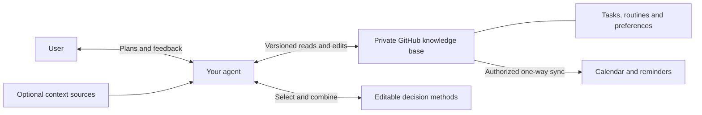

# Personal Agent Starter Kit

**Start in chat / 在对话中启动** · Copy this [SKILL.md launch link](https://raw.githubusercontent.com/pilaaaaaa/personal-agent-starter-kit/main/SKILL.md) into your usual AI chat. If the chat reads it without starting, add **“Start Personal Agent using this file. Begin onboarding and ask one question at a time.”** or **「请读取这个文件并启动 Personal Agent。开始初始化，每轮只问一个问题。」**.

Build a personal agent around the way you already work. Track commitments, plan around real constraints and refine your preferences in conversation. The kit gives capable agents a shared operating protocol, an empty private knowledge base and a library of editable decision methods.

- **Better decisions, less friction.** Replan as constraints, commitments and information change.
- **Your life, your rules.** Choose what your agent can do on its own and when it needs your approval.
- **Your data, your repository.** Keep durable personal knowledge in your own private GitHub repository. The public starter kit must contain only templates and fictional examples.
- **Your choice of AI agent.** Use an agent that can read the kit and has the tools required for your chosen setup.
- **Everything is customizable.** Edit or replace decision methods, personal preferences, system architecture and external connections.

## How does it work?



The agent distinguishes deadlines, reminder times and reserved work blocks. It checks dependencies, finds compatible activities and replans as new information arrives. Follow-up management tracks waiting items and brings them back for review in relevant conversations. Scheduled review requires a configured scheduler. The agent learns from feedback by recording confirmed lasting preferences and tracking temporary constraints separately. Git tracks shared state so agents can work from the same revision and detect concurrent changes.

## Quick start

Paste the launch link into an ordinary AI conversation and bring something you want to plan, track or decide. A chat that can read the link can start from there. If it cannot open URLs, attach the downloaded `SKILL.md` if uploads are supported. The Agent gives you a useful first result before asking about storage. You can choose to stay in chat, and optional integrations are handled one at a time. To resume on another platform, give it authorized access to your private workspace and branch, or hand it a portable checkpoint if you saved one. Chat-only progress otherwise depends on conversation access. See the [onboarding examples](onboarding/examples.md).

<details>
<summary>Manual setup for users who want a local workspace</summary>

Use Git and Python 3.9+ to initialize and validate an empty workspace.

```sh
python3 scripts/init_workspace.py ../my-private-agent
cd ../my-private-agent
git init -b main
python3 scripts/validate_tasks.py
```

Commit the initialized files before connecting sync. Verify GitHub visibility before sending any personal data. See [SKILL.md](SKILL.md) for Agent-led setup.

</details>

## Decision methods

The [decision library](methods/README.md) describes the 12 built-in methods, their uses and how to combine or replace them. Ask about a recommendation when you want to see how it was made.

## Integrations

GitHub stores durable tasks and planning knowledge. Google Calendar projection and Apple Reminders sync are optional. Email, calendar availability, weather, daylight and health context depend on the tools you authorize. You can supply context directly in conversation. The [integration guide](integrations/README.md) lists platform requirements, authorization, verification and fallbacks.

## Make it yours

Ask your agent to change the architecture, add or disable a method, choose a different data source, revise its planning logic or change its autonomy. Keep different agents pointed at the same private knowledge base and follow the [shared state protocol](docs/protocol.md). Your rules and routines can grow one conversation at a time.

[Follow a fictional library project](examples/scenarios.md) from task creation and replanning through parallel execution, waiting follow-ups and changes to preferences and permissions.

## Framework updates

Installed workspaces check [VERSION](VERSION) on first daily use by default. Upgrades require your approval and preserve your private state and custom methods. See the [changelog](CHANGELOG.md) and [update guide](UPDATE.md) for the check, manual upgrade and rollback paths.

## 中文快速入门

把顶部链接粘贴到常用 AI 的普通对话框。若它只展示或总结链接，再说「启动这个 Agent」。如果平台打不开链接，可以在支持上传时附上下载的 `SKILL.md`。告诉 Agent 一件你现在想处理的事，之后再按需要启用私人 GitHub 存储、日历或提醒。

## Verify and license

- **Included in the kit.** Agent instructions for dynamic planning, preference learning, follow-ups, graduated autonomy and onboarding, plus 12 editable methods, an empty workspace initializer, a validator and two optional sync adapters.
- **Verified locally.** The Python suite covers initialization, Git concurrency, the task lifecycle and Google Calendar behavior with simulated responses. A separate Swift harness checks Apple Reminders rules.
- **Live verification pending.** Google Calendar OAuth and live writes, Apple Reminders access and live sync, and GitHub Actions execution still need end-to-end verification with dedicated test accounts and targets. Agent behavior depends on its tools and permissions.

See the [verification guide](docs/verification.md) for the local checks. Copyright (c) 2026 Galatea. See the [MIT License](LICENSE).
