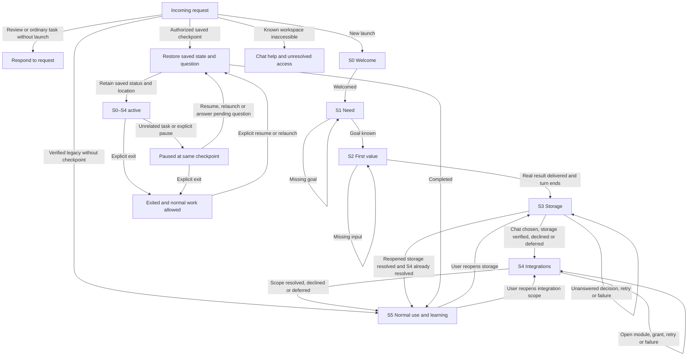

# Onboarding audit and design

Baseline: public main at `edc0beebf66f2d6b715be5ef5b49d968aea6989d` (0.2.0). The entry already recognized a bare launch link and excluded review requests. Failure could occur earlier if a host never fetched the file. After a successful fetch, “start onboarding” and “help immediately” had no shared continuation rule. The separate onboarding guide delegated timing of storage and integrations to the Agent. AGENTS.md defined daily operations without an onboarding gate. Protocol and update files described revision consistency and private setup, with no persisted onboarding progress. The initializer and manifest copied documentation and blank task/planning files. Existing regression tests checked copied references, task data and integration adapters. No fixture specified a conversational interrupt, transition guard, recovery, refusal or exit.

| Mechanism | Adopted design | Runtime boundary |
| --- | --- | --- |
| [Agent Skills specification](https://agentskills.io/specification) | Valid entry metadata, essential instructions at launch and deeper references on demand. | Native skill activation belongs to the host. Fetching a Raw URL in chat has no native activation guarantee. |
| [LangGraph Graph API](https://docs.langchain.com/oss/python/langgraph/graph-api) and [interrupts](https://docs.langchain.com/oss/python/langgraph/interrupts) | Explicit guarded states and a saved user-input boundary, with resume from a stable question key. | A LangGraph runtime enforces node and interrupt execution. This kit uses an Agent-followed protocol and Git conditional writes, with no runtime, server or database requirement. |
| [LangGraph persistence](https://docs.langchain.com/oss/python/langgraph/persistence) | Separate resumable state from long-term knowledge and reuse the authorized canonical workspace. | Git stores explicit checkpoints. Unavailable tool access or a failed write leaves session-only progress. |
| [Conversational preference elicitation study](https://arxiv.org/abs/2504.13095) | Elicit only context that affects actual work, adapt question wording, and confirm the scope of durable preferences. | This is a design choice informed by conversational recommender research. Its effect has yet to be measured for this kit. |

JSON provides a human-readable declaration with standard-library parsing. The schema constrains checkpoint shape and selected invariants. The interaction protocol specifies evidence and effects whose truth depends on the conversation or tools. Offline tests can validate the declared contract and curated traces. Platform tests must establish whether real products fetch the file, obey interrupts and expose the appropriate tools.

## State graph

